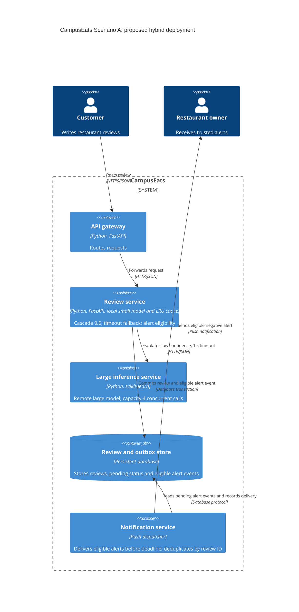

# Task 4: Deployment topologies and trade-offs

**Name / ชื่อ:** ชินนวุฒิ แก้วฉิม

**Student ID / รหัสนิสิต:** 6870063021

This is **individual work**: each student completes and submits their own copy, in their own fork.

*งานนี้เป็น**งานเดี่ยว** นิสิตแต่ละคนทำและส่งงานของตัวเอง ใน fork ของตัวเอง*

**Scenario (A, B or C) / Scenario ที่เลือก:** A — Owner alerts (เลขท้ายรหัสนิสิตเป็นเลขคี่)

Choose **one** scenario below. If the last digit of your student ID is odd, take A or B; if it is even, take B or C. Use your measurements from Tutorial 6 as evidence: cite run names from `results/runs.csv`. Answer in Thai or English.

เลือก scenario **หนึ่ง** ข้อด้านล่าง ถ้าเลขตัวสุดท้ายของรหัสนิสิตเป็นเลขคี่ ให้เลือก A หรือ B ถ้าเป็นเลขคู่ ให้เลือก B หรือ C ใช้ผลการวัดจาก tutorial ที่ทำไปเป็นข้อมูลอ้างอิง โดยอ้างชื่อ run จาก `results/runs.csv` จะตอบเป็นภาษาไทยหรือภาษาอังกฤษก็ได้

Facts that hold in every scenario / ข้อเท็จจริงที่ใช้กับทุก scenario:

- The large model serves at most **20 calls per second** (4 calls at once × about 200 ms each), and every call costs money.

  *large model รับได้สูงสุด **20 calls ต่อวินาที** (พร้อมกัน 4 calls × ประมาณ 200 ms ต่อ call) และทุก call มีค่าใช้จ่าย*
- The small model is fast and cheap enough to run anywhere, including inside the review service or on a kiosk, but it is much less accurate on its own.

  *small model เร็วและถูกพอที่จะรันที่ไหนก็ได้ รวมถึงภายใน review service หรือบน kiosk แต่ถ้าใช้ตัวเดียวจะแม่นน้อยกว่ามาก*

## Scenarios

**A. Owner alerts.** When a customer posts a negative review, the restaurant owner gets a push notification within **2 seconds**. At the lunch peak, CampusEats receives **40 reviews per second**. A missed alert is acceptable, but a wrong alert (for example, "your customer is unhappy" when they are happy) makes owners stop trusting alerts and, in the end, ignore them.

*เมื่อลูกค้าโพสต์รีวิวเชิงลบ เจ้าของร้านจะต้องได้รับ push notification ภายใน **2 วินาที** เวลาช่วงพีคตอนเที่ยง CampusEats ได้รับรีวิวจำนวน **40 รายการต่อวินาที** การพลาด alert ไปบ้างนั้นยอมรับได้ แต่ alert ที่ผิด (เช่น "ลูกค้าไม่พอใจ" ทั้งที่จริงๆ แล้วพอใจ) จะทำให้เจ้าของร้านไม่เชื่อถือและเลิกสนใจ alert ในที่สุด*

**B. Canteen kiosk.** A tablet in each canteen lets students leave a review on the spot. However, the canteen Wi-Fi is poor: the tablets lose their connection several times a day, for minutes at a time. The system must accept every review, even while a tablet is offline. Restaurant owners need the labels **by the end of the day**.

*มี tablet ในแต่ละโรงอาหารให้นิสิตรีวิวได้ทันที อย่างไรก็ดี การเชื่อมต่อ Wi-Fi ในโรงอาหารไม่ดี ทำให้ tablet หลุดการเชื่อมต่อวันละหลายครั้ง ครั้งละหลายนาที ระบบจะต้องรับรีวิวได้ทุกรายการแม้ขณะที่กำลัง offline อยู่ และเจ้าของร้านต้องการ label **ภายในสิ้นวัน***

**C. Weekly report.** Restaurant owners want a weekly sentiment report. Nothing in producing this report has to be real-time. **Accuracy matters most** and **cost must be minimal**.

*เจ้าของร้านต้องการรายงาน sentiment รายสัปดาห์ ไม่มีอะไรที่จะต้องทำแบบ real-time ในการออกรายงานนี้ ความแม่นยำ **(accuracy) สำคัญที่สุด** และ **ค่าใช้จ่ายต้องน้อยที่สุด***

## Topologies and patterns to choose from / Topology และ pattern ที่เลือกใช้ได้

| | Topology | Where the model runs / โมเดลรันที่ไหน |
|---|---|---|
| T1 | Model as a service, synchronous | Inference service, called for each review (today's baseline) *inference service ถูกเรียกทุกรีวิว (baseline ของวันนี้)* |
| T2 | Model as a library | Inside the review service, or on the device *ภายใน review service หรือบนอุปกรณ์* |
| T3 | Hybrid | Small model locally, large model as a remote service *small model รันในเครื่อง large model เป็น remote service* |
| T4 | Asynchronous / batch | Reviews are queued (broker, W10) or stored, and scored later in bulk *รีวิวถูกเข้าคิว (broker, W10) หรือเก็บไว้ แล้วติด label ทีหลังเป็นชุด* |

Combine one topology with any of the patterns from Tutorial 6: **fallback**, **cascade** and **cache**.

*เลือก topology หนึ่งแบบ แล้วผสมกับ pattern จาก Tutorial 6 ได้ตามต้องการ: **fallback**, **cascade** และ **cache***

## 1. Quality requirements

The three most important quality requirements for your scenario, each with a number where possible.

*quality requirements ที่สำคัญที่สุด 3 ข้อของ scenario ที่เลือก ระบุตัวเลขเมื่อทำได้*

| # | Quality | Requirement |
|---|---|---|
| 1 | Performance / timeliness | แจ้งเตือน negative review ที่ผ่านเกณฑ์ภายใน 2 วินาที ที่ peak 40 รีวิว/s; วัด end-to-end ถึงอุปกรณ์เจ้าของร้าน |
| 2 | Accuracy / trust | label accuracy อย่างน้อย 90% ตาม QR3 และให้ความสำคัญกับ precision ของ negative alerts; เสนอเป้าหมาย precision ≥99% ซึ่งต้องยืนยันด้วยผู้ใช้และข้อมูล validation เพราะ scenario ไม่ระบุตัวเลข |
| 3 | Capacity / cost | เรียก large model ไม่เกิน 20 calls/s พร้อมกันไม่เกิน 4 calls และลดจำนวน calls ให้เหลือ capacity สำรอง |

## 2. Design / การออกแบบ

Your topology, the patterns you add, and a container-level diagram (C4 level 2). The C4 diagram must be written in Mermaid.

*topology ที่เลือก pattern ที่เพิ่ม และ diagram ระดับ container (C4 level 2) เขียนด้วย Mermaid*

เลือก **T3 Hybrid**: small model และ LRU prediction cache อยู่ใน review service ส่วน large model เป็น remote inference service ใช้ cascade threshold 0.6, cache ที่ผูก model version และ fallback หลังรอ 1 วินาที โดยเก็บรีวิวและ pending อย่างคงทน

แยกนโยบายติด label ออกจากนโยบายแจ้งเตือน: ส่ง alert เฉพาะ negative ที่มีหลักฐานว่าเป็นผลจาก large model และผ่านเกณฑ์ confidence ที่ปรับเทียบด้วย validation set; negative ที่มาจาก small model อย่างเดียวหรือ pending จะไม่ส่ง alert ทันที เพราะ scenario ยอมให้พลาดได้ หาก cache ถูกใช้ต้องเก็บ provenance/confidence/model version เดิมไว้เพื่อใช้เกณฑ์เดียวกัน และไม่ตีความ confidence เป็นความแม่นยำที่รับประกัน

งบเวลาเสนอ: ประมวลผล/รอ inference ไม่เกินประมาณ 1 วินาที เหลือประมาณ 1 วินาทีสำหรับบันทึกและส่ง push; dispatcher ต้องตรวจ deadline และหยุดส่ง alert ที่หมดอายุแทนการส่งผิดเวลา การเก็บ pending เพื่อจัดการภายหลังไม่ถือว่าทำ alert ทัน SLA และต้องติดตาม missed/expired alerts แยกต่างหาก

## 3. Evidence / หลักฐาน

Which runs support your choice? Show the numbers and, for scenario A, the capacity arithmetic: how many large-model calls per second does your design need at the peak?

*run ไหนที่สนับสนุนการตัดสินใจของนิสิต ให้นิสิตแสดงตัวเลขประกอบ และสำหรับ scenario A ให้นิสิตแสดงการคำนวณ capacity ด้วย เพื่อแสดงว่าในช่วงพีคนั้น design ของนิสิตต้องใช้ large model กี่ calls ต่อวินาที*

| Run | What it shows / แสดงอะไร |
|---|---|
| t0-large / t0-small | large: accuracy 93.5%, p95 599 ms, large calls 100%; small: accuracy 72.5%, p95 21 ms จึงใช้ small เพียงตัวเดียวไม่ได้ตาม QR3 |
| t1-before / t1-after | ก่อน fallback: errors 20, run 26.4 s; หลัง fallback: errors 0, pending 25, run 9.5 s, p95 1,009 ms แสดงว่าหยุดรอได้ แต่ pending ต้องจัดการต่อ |
| t2-0.6 | accuracy 91.5%, p50 5 ms, p95 545 ms, large calls 38% เป็นจุดที่ผ่าน accuracy และประมาณการ capacity แบบไม่พึ่ง cache |
| t2-0.7 / t2-0.8 / t2-0.9 | accuracy 93.0% / 93.5% / 93.5% แต่ large calls 53% / 64% / 77% คิดเป็น 21.2 / 25.6 / 30.8 calls/s ที่ peak ซึ่งเกิน 20 หากไม่มี cache |
| t3-cache (threshold 0.6) | accuracy 91.5%, cache hits 36%, large calls 31%, p50 5 ms, p95 586 ms ลดต้นทุน แต่ p95 ไม่ดีขึ้นใน run นี้ |

**Capacity arithmetic:** ไม่มี cache: 40 × 0.38 ≈ **15.2 large calls/s** เหลือประมาณ 4.8 calls/s; มี cache ตาม t3-cache: 40 × 0.31 ≈ **12.4 calls/s** เหลือประมาณ 7.6 calls/s ใช้ large_calls ที่วัดจริงโดยตรง ไม่คูณ cache-hit rate ซ้ำ และตัวเลขเปอร์เซ็นต์ใน CSV ถูกปัดเศษ จึงเป็นค่าประมาณ

การกรอง alert ข้างต้นไม่เรียก large model เพิ่มเพื่อยืนยันผล small-negative จึงไม่เพิ่ม calls ในสมการนี้ แต่ต้องยอมพลาด alerts บางรายการ ทั้งนี้ cold cache ที่ workload แบบเดิมยังประมาณได้ 15.2 calls/s; ถ้าสัดส่วนข้อความยากสูงขึ้นจน escalation เกิน 50% จะเกิน capacity ที่ peak ต้องมี bounded queue/admission control และ fallback สำหรับงานที่เสี่ยงเกิน deadline

**ขอบเขตหลักฐาน:** load tests เป็น 200 requests ที่ concurrency 10 ไม่ใช่การยิงคงที่ 40 รีวิว/s และ p95 ของ API ไม่ใช่เวลาที่เจ้าของร้านได้รับ push การคำนวณอาศัยสมมติฐานว่า workload mix เดิม อีกทั้ง global accuracy 91.5% ไม่ได้พิสูจน์ negative-alert precision ≥99%; ต้องทดสอบ sustained peak, cold cache, push delivery และ precision/recall ของ alert gate เพิ่มก่อนอนุมัติ deployment จริง ไม่สามารถรับประกันว่าไม่มี alert ผิดจากผลทดลองชุดนี้

## 4. ADR

Use the ADR format from W5.

*ใช้รูปแบบ ADR จาก W5*

**Title:** ใช้ Hybrid cascade พร้อม cache และนโยบายคัดกรอง negative alerts สำหรับ CampusEats Scenario A

**Status:** Proposed

**Context:** ช่วงเที่ยงมี 40 รีวิว/s ต้องแจ้งเตือนภายใน 2 วินาที และ alert ผิดทำลายความเชื่อถือของเจ้าของร้าน ขณะที่ large model รองรับได้เพียง 20 calls/s และมีค่าใช้จ่ายทุก call; t0-small มี accuracy 72.5% ต่ำกว่า QR3 ส่วนการใช้ large ทุกรีวิวต้องการ 40 calls/s เกิน capacity

**Decision:** เลือก T3 โดยวาง small model และ cache ภายใน review service และเรียก remote large model เมื่อ confidence ต่ำกว่า 0.6 ใช้ timeout/fallback 1 วินาทีพร้อม durable review store และ transactional outbox; ให้ dispatcher ส่งเฉพาะ large-derived negative ที่ผ่าน alert gate ซึ่งจะปรับเทียบและตรวจ precision บน validation set ก่อนใช้งานจริง โดยเก็บ provenance ของผล cache ไว้ด้วย

ที่ workload แบบเดียวกับ t2-0.6 ต้องการประมาณ 15.2 large calls/s และ t3-cache ลดเหลือประมาณ 12.4 calls/s เลือกไม่ยืนยัน small-negative เพิ่มทุกตัว เพราะยังไม่มีผลวัด capacity ของนโยบายดังกล่าว กำหนดให้ปิดการส่ง alert อัตโนมัติจนผ่านการตรวจ precision และ end-to-end deadline; ADR นี้จึงคงสถานะ Proposed

**Consequences:**
- Positive: ลด large-model cost และปริมาณงานให้อยู่ใต้ capacity ตามสัดส่วน workload ที่วัดได้; fallback ช่วยให้รับรีวิวต่อได้เมื่อ inference ค้าง; การงด alert ที่หลักฐานไม่พอลดความเสี่ยงต่อความเชื่อถือโดยยอมลด recall
- Negative: accuracy ของ labels ลดจาก 93.5% เป็น 91.5%; พลาด negative alerts จาก small model และ pending; ต้องดูแล model/cache version, durable storage, outbox และการป้องกัน push ซ้ำ รวมทั้งยังต้องพิสูจน์ precision กับ latency ของระบบแจ้งเตือนจริง

**Alternatives considered:** at least one topology you rejected, and why.

*อย่างน้อยหนึ่ง topology ที่ไม่เลือก และเหตุผล*

> ไม่เลือก T1 ที่ใช้ large ทุกรีวิว เพราะต้องการ 40 calls/s เกิน capacity 20 calls/s และแพงที่สุด; ไม่เลือก T2 small-only เพราะ accuracy 72.5% ไม่ผ่าน QR3 และยังเสี่ยง alert ผิด; ไม่เลือก T4 batch เป็นเส้นทางหลักของ alerts เพราะการรอ batch ไม่รองรับ deadline 2 วินาที แม้จะเหมาะสำหรับติด label pending ภายหลัง
